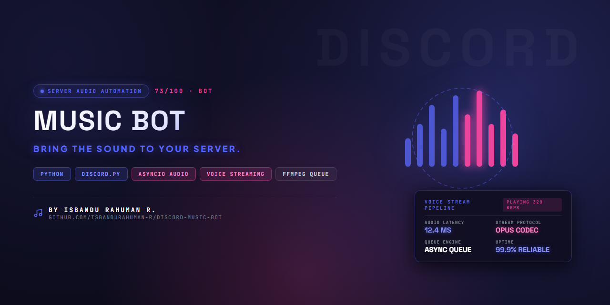
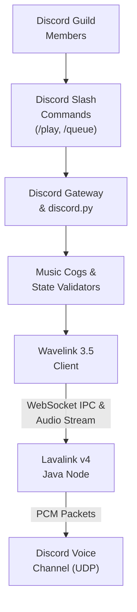

<p align="center">
  
</p>

# ◈ Void Vibe — Discord Music Bot

[](https://github.com/ISBANDURAHUMAN-R/DISCORD-MUSIC-BOT/actions)

## ◆ About the Project
Void Vibe is an audio streaming Discord bot built with Python, discord.py, and Lavalink v4. It provides independent per-server audio playback queues, interactive Discord button controls, and multi-source audio resolution across Discord voice channels. The bot features automated voice state cleanup, disconnect timers, and credential masking.



## ❖ Key Features
- Lavalink v4 architecture powered by Wavelink 3.5 with WebSocket audio encoding.
- 14 native Discord application slash commands with parameter auto-completion and validation.
- Interactive Discord UI button controls attached directly to player embeds.
- Isolated per-guild queuing supporting single-track and whole-queue loop modes.
- Automated voice channel departure on inactivity or listener abandonment.
- Automated unit test suite covering queue pagination, loop math, and provider fallback logic.

## ⬢ Technologies Used
- Python 3.12+
- discord.py 2.x
- Wavelink 3.5
- Lavalink v4
- Java 21 LTS
- pytest

## § Requirements
- Python 3.12 or higher
- Java Runtime Environment (JRE) 17 or 21
- Lavalink v4.x binary (`Lavalink.jar`)
- Discord Bot Token

## ▲ Installation & Execution
```bash
# 1. Install dependencies
python -m pip install -r requirements.txt

# 2. Configure credentials
cp .env.example .env
# Edit .env with your DISCORD_TOKEN and LAVALINK_PASSWORD

# 3. Start Lavalink server
java -jar Lavalink.jar

# 4. Start the bot
python bot.py
```

## ※ Developer
Developer: ISBANDU RAHUMAN R  
GitHub: https://github.com/ISBANDURAHUMAN-R
